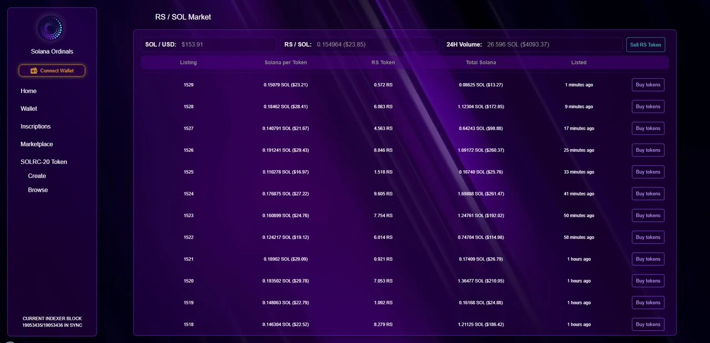

# Solana Ordinals - рынок ROCKETSOL

**Автор проекта:** [Евгений Толмачев](https://github.com/EvgenyET) · [Страница проекта в портфолио](https://evgeny-dev.pro/project/solana_ordinals/solana_ordinals.html)

Прототип рынка на Solana. Показывает заявки, пересчитывает цены в SOL и долларах и подключает кошелёк Phantom.

## Мой вклад

Разработал таблицу заявок ROCKETSOL и связал её с сервером данных. Для сравнения предложений сделал пересчёт цен в SOL и доллары, добавил постраничный просмотр рынка и подключение кошелька Phantom.

## Интерфейс

**Таблица заявок рынка ROCKETSOL**

**Подключение кошелька из интерфейса рынка**

## Как это работает

В таблице рынка видны номер листинга, цена токена, количество токенов и общая стоимость заявки. Пагинация позволяет перелистывать предложения, а курс SOL даёт ориентир для сравнения цен.

## Возможности

- Просмотр листингов ROCKETSOL с постраничной навигацией.
- Подключение Phantom и отображение состояния кошелька.
- Пересчёт показателей по курсу SOL.

## Технологии

Solana, Phantom Wallet, @solana/web3.js, JavaScript (ES6), Webpack 5, Babel, HTML5/CSS, Fetch API, Pagination, UI/UX, Design.
