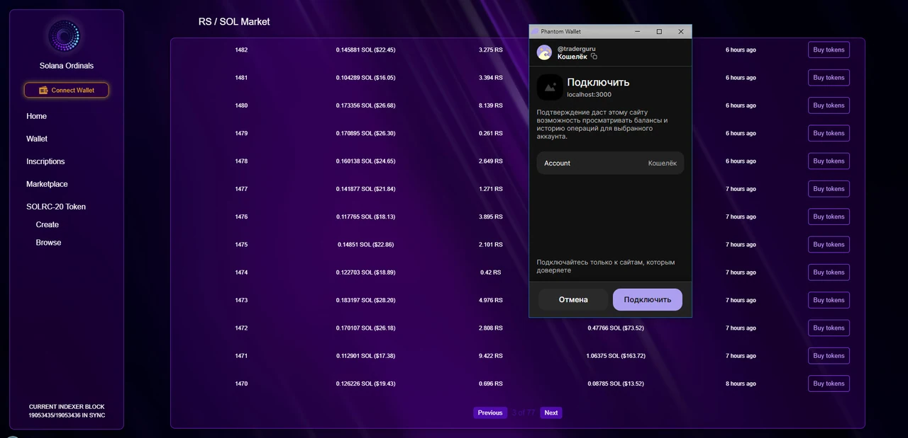

# Solana Ordinals - рынок ROCKETSOL

Автор проекта - **Евгений Толмачев**. [Профиль GitHub](https://github.com/EvgenyET) · [Проект в портфолио](https://evgeny-dev.pro/project/solana_ordinals/solana_ordinals.html)

Веб-интерфейс рынка ROCKETSOL на Solana. Таблица предложений с пагинацией, сравнение цен в SOL и долларах, подключение кошелька Phantom.

## Задача проекта

Проект решает задачу представления рыночных данных в браузере. В нём объединены таблица с серверной пагинацией, периодическое обновление курса и работа с состоянием внешнего кошелька. Портфолио демонстрирует сохранённый прототип рынка и подключения Phantom.

## Мой вклад

Разработал интерфейс таблицы и её связь с API, вывод цен и навигацию по страницам. Добавил получение курса SOL, обновление показателей и обработку подключения Phantom. Связал клиентскую часть с сервером и хранилищем, чтобы экран строился по записям рынка.

## Интерфейс

**Таблица заявок рынка ROCKETSOL**

**Подключение кошелька из интерфейса рынка**

## Как работает приложение

Solana Ordinals - прототип интерфейса для просмотра предложений ROCKETSOL. Пользователь сравнивает количество токенов, цену за единицу, стоимость предложения и время его появления, а затем переходит между страницами рынка. Курс SOL помогает сопоставлять значения в криптовалюте и долларах. Подключение Phantom встроено в боковую навигацию и отражается в состоянии интерфейса.

## Возможности

- Таблица с номером листинга, количеством токенов, ценой за единицу, общей стоимостью и временем размещения.
- Постраничная загрузка предложений с сервера.
- Сопоставление цен в SOL и долларах с обновлением курса.
- Подключение Phantom и отображение состояния кошелька в навигации.

## Техническое устройство

### Таблица рынка

Экран рынка запрашивает записи с сервера и строит строки таблицы. Количество токенов и цена относятся к конкретному листингу, а текущий курс SOL даёт вторую единицу для сравнения предложений.

### Кошелёк

Кнопка кошелька открывает сценарий Phantom. Клиент получает публичный адрес и обновляет состояние интерфейса после подключения.

### Хранилище

Сервер выдаёт данные рынка из хранилища. Страница таблицы и модуль подключения кошелька обращаются к разным частям приложения.

## Технологии

| Технология | Роль в проекте |
| --- | --- |
| JavaScript | Данные таблицы, расчёты и переходы между страницами. |
| Phantom | Подключение Solana-кошелька из браузера. |
| Node.js | Серверная выдача данных для рынка. |

## Состояние показанной версии

- В портфолио представлена версия прототипа рынка. Завершённый торговый цикл с расчётами между участниками в демонстрации не подтверждён.

## Демонстрация

На странице портфолио доступны описание, галерея и видеодемонстрация проекта. [Открыть Solana Ordinals - рынок ROCKETSOL](https://evgeny-dev.pro/project/solana_ordinals/solana_ordinals.html).
